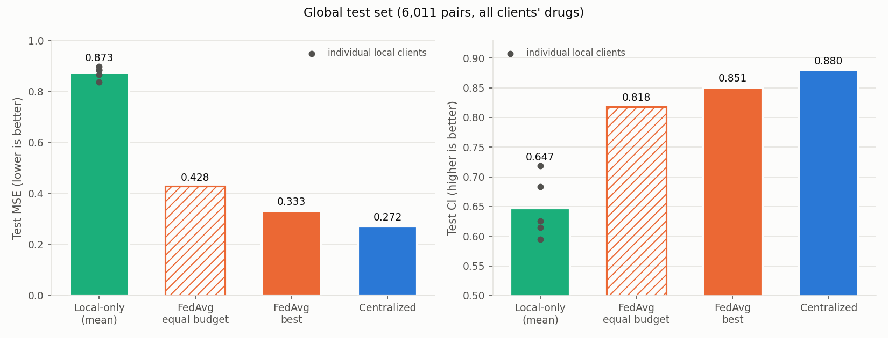
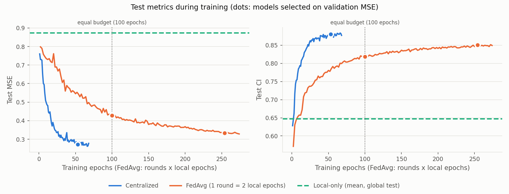
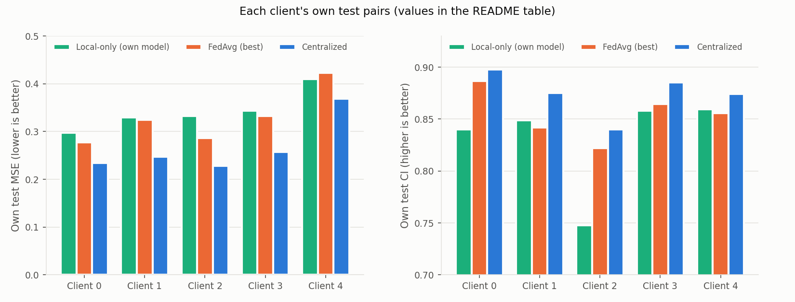
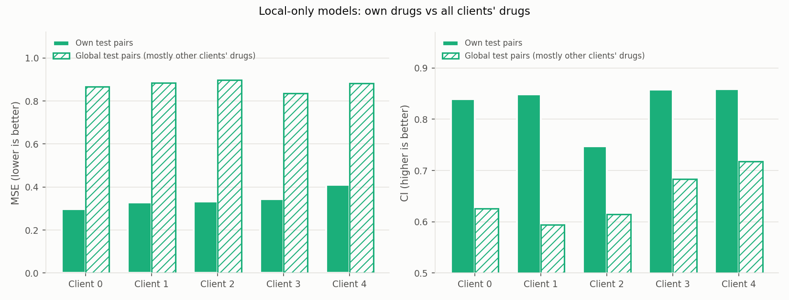
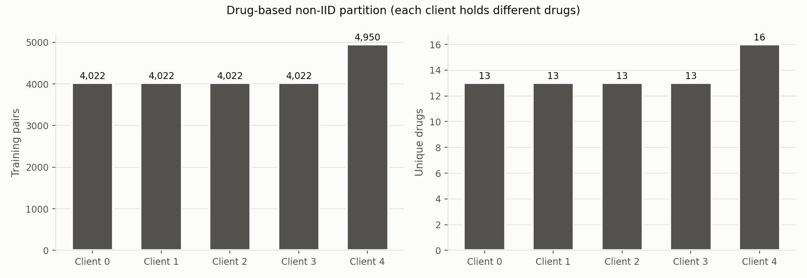

# Federated Learning for Drug-Target Interaction Prediction

Federated learning (FedAvg) for drug–target binding affinity prediction on the DAVIS dataset,
built on DeepPurpose (MPNN drug encoder + CNN protein encoder). The 68 drugs are split across
5 clients, so each client holds different drugs (non-IID). We compare three settings on the same data split:

- **Centralized**: one model trained on all clients' training data (reference upper bound; requires sharing data).
- **Local-only**: each client trains alone on its own data (lower bound; no collaboration).
- **FedAvg**: clients train locally and only share model weights (plus each client's label mean and sample
  count once, for bias initialisation); the server averages the weights, weighted by sample count.

This project builds on DeepPurpose (Huang et al., 2020): it uses DeepPurpose's MPNN-CNN model and
featurisation, and adds a federated learning layer (client–server training, FedAvg aggregation, non-IID
partitioning and federated evaluation).

## Summary

FedAvg closes 90% (MSE) / 87% (CI) of the gap between local-only and centralized training at convergence, and 73–74% at equal training budget. Local-only models fail on other clients' drugs: on the global test set every local model has R² < 0. The centralized reference reaches MSE 0.272 / CI 0.880.



## Setup

- **Data:** DAVIS, 30,056 drug–target pairs (68 drugs × 442 kinases), labels as pKd = −log10(Kd [M]).
- **Clients:** the 68 drugs are shuffled and divided over 5 clients (13, 13, 13, 13 and 16 drugs).
  Each client's pairs are split at random 70/10/20 into train/val/test (seed 42). The global
  validation and test sets are the union of the client sets (3,007 and 6,011 pairs).
- **Model selection:** every method keeps the epoch/round with the lowest validation MSE; that model is reported.
- **Common settings:** Adam, learning rate 1e-3, batch size 128, output bias initialised to the mean
  training label, seed 42.

| Method | Settings | Training actually run |
|---|---|---|
| Centralized | max 100 epochs, early stopping patience 15 | stopped after epoch 68, best epoch 53 |
| FedAvg | max 150 rounds × 2 local epochs, patience 10; clients keep their Adam state | stopped after round 137, best round 127 |
| Local-only | max 100 epochs per client, patience 15 | clients stopped after 100 / 68 / 84 / 88 / 79 epochs |

The FedAvg run was extended in three Colab sessions through checkpoint resume (round limit 50 → 100 → 150).
The run was extended because validation MSE was still improving; all decisions and model selection used
validation data only. Early stopping first triggered after round 137, so the result is equivalent to a
single 150-round run (resume was verified to be identical on CPU; on GPU, results may differ in the last
decimals due to non-deterministic CUDA operations).

## Results

### Global test set (6,011 pairs, all clients' drugs)

| Method | Training budget | MSE ↓ | Pearson ↑ | CI ↑ | R² ↑ |
|---|---|---|---|---|---|
| Centralized | 68 epochs (best epoch 53) | **0.272** | **0.815** | **0.880** | **0.66** |
| FedAvg, equal budget | 50 rounds × 2 local epochs (best of rounds 1–50: round 50) | 0.428 | 0.682 | 0.818 | 0.46 |
| FedAvg, best | 137 rounds × 2 local epochs (best round 127) | 0.333 | 0.766 | 0.851 | 0.58 |
| Local-only (mean of the 5 client models) | up to 100 epochs per client | 0.873 | 0.312 | 0.647 | −0.09 |

*Equal budget* is the model a 50-round FedAvg run would have selected: the round with the lowest
validation MSE among rounds 1–50. 50 rounds × 2 local epochs = 100 epochs of local training per
client, matching the centralized 100-epoch limit.

**Gap closed by FedAvg** = (local − FedAvg) / (local − centralized), on the global test set:

| FedAvg | MSE | CI |
|---|---|---|
| Equal budget | 74% | 73% |
| Best | 90% | 87% |



### Each client's own test pairs (MSE / CI)

| Client | Train pairs | Local-only | FedAvg, equal budget | FedAvg, best | Centralized |
|---|---|---|---|---|---|
| 0 | 4,022 | 0.298 / 0.840 | 0.390 / 0.846 | 0.278 / 0.886 | 0.234 / 0.898 |
| 1 | 4,022 | 0.329 / 0.849 | 0.386 / 0.805 | 0.324 / 0.842 | 0.247 / 0.875 |
| 2 | 4,022 | 0.333 / 0.748 | 0.393 / 0.745 | 0.286 / 0.822 | 0.228 / 0.840 |
| 3 | 4,022 | 0.343 / 0.858 | 0.449 / 0.848 | 0.332 / 0.864 | 0.257 / 0.885 |
| 4 | 4,950 | 0.410 / 0.859 | 0.507 / 0.837 | 0.423 / 0.856 | 0.368 / 0.874 |
| Mean | | 0.343 / 0.831 | 0.425 / 0.816 | 0.329 / 0.854 | 0.267 / 0.874 |



### Local-only models on their own drugs vs all drugs

| Local-only model | Best epoch | Own test MSE / CI | Global test MSE / CI |
|---|---|---|---|
| Client 0 | 100 (epoch limit) | 0.298 / 0.840 | 0.866 / 0.626 |
| Client 1 | 53 | 0.329 / 0.849 | 0.884 / 0.595 |
| Client 2 | 69 | 0.333 / 0.748 | 0.897 / 0.615 |
| Client 3 | 73 | 0.343 / 0.858 | 0.836 / 0.683 |
| Client 4 | 64 | 0.410 / 0.859 | 0.882 / 0.718 |





### Key findings

1. **Local-only models do not transfer to other clients' drugs.** On their own test pairs they reach
   CI 0.75–0.86, but on the global test set (about 80% other clients' drugs) CI drops to 0.59–0.72
   and R² is below zero, i.e. worse than predicting the mean.
2. **FedAvg recovers most of the centralized performance without sharing raw data.** On the global test
   set it closes 90% (MSE) and 87% (CI) of the local-to-centralized gap at convergence, and 73–74% at
   equal training budget.
3. **With these hyperparameters, FedAvg converges more slowly than centralized training.** Centralized
   training reaches its best model at epoch 53, FedAvg at round 127 (254 local epochs). At a
   100-epoch-equivalent budget, FedAvg is behind (CI 0.818 vs 0.880).
4. **The main gain of federation is on other clients' drugs.** On each client's own test pairs, the
   converged FedAvg model improves on local-only for clients 0, 2 and 3 (largest for client 2:
   CI 0.748 → 0.822), is about equal for client 1, and **shows no measurable benefit for client 4** (MSE 0.423 vs
   0.410, CI 0.856 vs 0.859). At equal budget, FedAvg is behind local-only on every client's own drugs
   in MSE. Centralized training is best for every client.

### Caveats

- **Single seed (42).** No repeated runs yet, so no confidence intervals; small differences
  (e.g. client 1, client 4) may not be significant.
- **Random (warm) test split.** Test pairs are sampled at random within each client, so every test
  drug also appears in some client's training data. This does not measure performance on new drugs.
- **Server-held global validation set.** Model selection (best epoch/round, early stopping) uses the
  pooled validation sets of all clients. In a real deployment the server would not hold this data.
- **Local client 0 reached the 100-epoch limit** without early stopping (its best epoch was the last).
- **Shared, untuned hyperparameters.** Learning rate, batch size and local epochs were the same for all
  methods and not tuned per method, which may disadvantage FedAvg.
- **One small dataset.** Only DAVIS (68 drugs, about 13–16 drugs per client).
- **Local-only baseline is the mean of individual client models.** An ensemble of local models
  (averaging their predictions) would be a stronger non-federated baseline and is not included.

All numbers above are computed by `experiments/generate_plots.py` from the result files in
`results/runs/` (also written to `results/summary.md`).

## Related work and references

This project is an open, reproducible FedAvg framework built on DeepPurpose (Huang et al., 2020),
evaluated on DAVIS (Davis et al., 2011) with a drug-based non-IID split and a per-client analysis that
separates performance on a client's own drugs from performance on other clients' drugs. It uses the
standard FedAvg algorithm (McMahan et al., 2017) and does not propose a new federated learning method.

The closest prior work is Mittone et al. (2023), a federated learning benchmark for drug–target
interaction that applied FedAvg to GraphDTA on the KIBA dataset.

- Huang, K., Fu, T., Glass, L. M., Zitnik, M., Xiao, C., & Sun, J. (2020). DeepPurpose: a deep learning
  library for drug–target interaction prediction. *Bioinformatics*, 36(22–23), 5545–5547.
- Davis, M. I., Hunt, J. P., Herrgard, S., Ciceri, P., Wodicka, L. M., Pallares, G., Hocker, M.,
  Treiber, D. K., & Zarrinkar, P. P. (2011). Comprehensive analysis of kinase inhibitor selectivity.
  *Nature Biotechnology*, 29, 1046–1051.
- McMahan, H. B., Moore, E., Ramage, D., Hampson, S., & Agüera y Arcas, B. (2017). Communication-efficient
  learning of deep networks from decentralized data. *Proceedings of AISTATS 2017*, PMLR 54, 1273–1282.
- Mittone, G., et al. (2023). A Federated Learning Benchmark for Drug-Target Interaction.
  *Companion Proceedings of the ACM Web Conference 2023 (WWW '23 Companion)*.
- Li, T., Sahu, A. K., Zaheer, M., Sanjabi, M., Talwalkar, A., & Smith, V. (2020). Federated optimization
  in heterogeneous networks. *Proceedings of MLSys 2020*.
- Karimireddy, S. P., Kale, S., Mohri, M., Reddi, S. J., Stich, S. U., & Suresh, A. T. (2020). SCAFFOLD:
  Stochastic controlled averaging for federated learning. *Proceedings of ICML 2020*.

## Project Structure
```
federated-deeppurpose/
├── data/                              # DAVIS dataset
│   └── splits/                        # Fixed client/train/val/test split (indices)
├── experiments/
│   ├── run_centralized.py             # Centralized baseline
│   ├── run_local.py                   # Local-only baseline (no communication)
│   ├── run_federated.py               # FedAvg
│   └── generate_plots.py
├── federated/
│   ├── client.py                      # Local training from the global weights
│   ├── server.py                      # Sample-weighted FedAvg aggregation
│   └── fedavg.py                      # Communication rounds, checkpointing
├── utils/
│   ├── load_davis.py                  # Data loading
│   ├── data_split.py                  # Drug-based non-IID partition
│   ├── protocol.py                    # Shared train/val/test protocol, pKd transform
│   ├── features.py                    # DeepPurpose featurisation, cached protein encoding
│   ├── engine.py                      # Device, model, metrics, checkpoints, CSV logs
│   └── trainer.py                     # Epoch loop with resume (baselines)
├── notebooks/colab_run.ipynb          # Run on Google Colab
├── docs/
│   └── NOTES.md                       # What changed in each step, why, and how it works
├── tests/
│   ├── smoke_test.py                  # Quick CPU test of all scripts + resume
│   └── verify_protein_cache.py        # Cached encoding == DeepPurpose encoding
├── results/
│   ├── runs/                          # Result files of the three runs (CSV/JSON)
│   ├── summary.md / summary.json      # Tables computed by generate_plots.py
│   └── *.png / *.pdf                  # Figures
├── third_party/
│   └── DeepPurpose_LICENSE            # License of adapted DeepPurpose code (BSD-3-Clause)
├── requirements.txt                   # Minimal dependency list
├── requirements_fixed.txt             # Tested local environment (Python 3.10, CPU)
├── requirements_colab.txt             # Extra packages installed on Colab
└── README.md
```

## Next Steps

- Repeat all methods with more seeds and report mean ± std.
- Add a cold-drug split (test drugs unseen by every client).
- Evaluate on the KIBA dataset.
- Study the robustness of federated DTI training to corrupted or manipulated clients.
- Compare against an ensemble of local models, as in Mittone et al. (2023).
- Tune FL-specific hyperparameters (local epochs, learning rate) and try FedProx (Li et al., 2020) /
  SCAFFOLD (Karimireddy et al., 2020).

## Technologies
- DeepPurpose 0.1.5 (PyTorch backend), MPNN drug encoder + CNN protein encoder
- NumPy, Pandas, Matplotlib, scikit-learn, lifelines
- **Results** were produced on Google Colab: Tesla T4 GPU, Python 3.13, PyTorch 2.11 + CUDA.
- **Tested local development environment:** Python 3.10 with CPU-only PyTorch 2.0.1 (`requirements_fixed.txt`).

## How to Run

All scripts use CUDA when available and fall back to CPU (`--device cpu|cuda` to force).

```bash
# Install (see requirements_fixed.txt for the tested local CPU environment)
conda create -n fedpurpose python=3.10 && conda activate fedpurpose
pip install torch==2.0.1 --index-url https://download.pytorch.org/whl/cpu
pip install -r requirements_fixed.txt
pip install --no-deps DeepPurpose==0.1.5

# Quick CPU checks
python tests/smoke_test.py
python tests/verify_protein_cache.py

# Experiments (settings used for the results above)
python experiments/run_centralized.py --epochs 100 --patience 15 --output-dir outputs/central_full_s42
python experiments/run_local.py       --epochs 100 --patience 15 --output-dir outputs/local_full_s42
python experiments/run_federated.py   --rounds 150 --local-epochs 2 --patience 10 --output-dir outputs/fedavg_full_e2_s42

# Tables and figures from the result files in results/runs/
python experiments/generate_plots.py
```

`pip check` will report `ax-platform` and `dgllife` as missing. This is expected: DeepPurpose lists them
as requirements, but they are not needed for MPNN-CNN, so DeepPurpose is installed with `--no-deps`.

Common options: `--resume`, `--seed`, `--lr`, `--batch-size`, `--num-workers`, `--subsample 0.05` (quick tests),
`--patience N` (early stopping: stop when val MSE has not improved for N epochs/rounds; off by default).
The reported model is always the one with the lowest validation MSE.

Two training choices (see `docs/NOTES.md` for why):
- **Output-bias initialisation (all methods):** the model's output bias starts at the mean training
  label (pKd), so training does not begin from predictions of ~0. In FedAvg this mean is the
  sample-weighted mean of the client label means. Disable with `--init-bias none`.
- **Client optimizer state (FedAvg):** each client keeps its own Adam state between rounds. Resetting
  Adam every round made all predictions swing up and down by 1–3 pKd from round to round. The old
  behaviour is available with `--reset-client-optimizer`.

Each run directory contains `config.json`, `last.pt` (checkpoint after every epoch/round), `best.pt`
(lowest validation MSE), `metrics.csv` (one row per epoch/round), `client_metrics.csv` (per-client
val/test metrics) and `final_metrics.json` (best model on val and test).
An existing run is never overwritten: add `--resume` to continue it, or use a new `--output-dir`.

All methods use the same split (`data/splits/protocol_seed42.csv`): each client's pairs are split
70/10/20 into train/val/test; the global val/test sets are the union of the client sets, and the
centralized model trains on the union of the client training sets.

## Running on Colab

Use Colab's GPU for long runs; keep a local CPU environment for development.

1. Fork or clone this repository.
2. Open `notebooks/colab_run.ipynb` in Colab (File → Open notebook → GitHub) and select a GPU runtime.
3. In the config cells set `REPO_URL` and `BRANCH` (the repository and branch the notebook clones,
   default `master`), `EXPERIMENT` (`centralized`, `local` or `fedavg`), `RUN_NAME` and the hyperparameters.
4. Run all cells. The notebook mounts Google Drive, clones the repo, installs the extra packages
   without replacing Colab's PyTorch, and writes checkpoints and CSVs to
   `MyDrive/federated-deeppurpose/outputs/<RUN_NAME>/`.
5. If the session disconnects, run all cells again with the same `RUN_NAME`; training resumes from the last checkpoint.

## License

No license has been chosen yet. Suggested: **BSD-3-Clause**, the license of DeepPurpose, on which this
project builds. A `LICENSE` file will be added once the license is confirmed. The DAVIS data in `data/`
comes from Davis et al. (2011) and is not covered by this project's license.

Parts of `utils/features.py`, `utils/engine.py` and `tests/verify_protein_cache.py` are adapted from
DeepPurpose (marked in each file's header). DeepPurpose's BSD-3-Clause license is included in
`third_party/DeepPurpose_LICENSE`.

## Author

[Name], [email]
